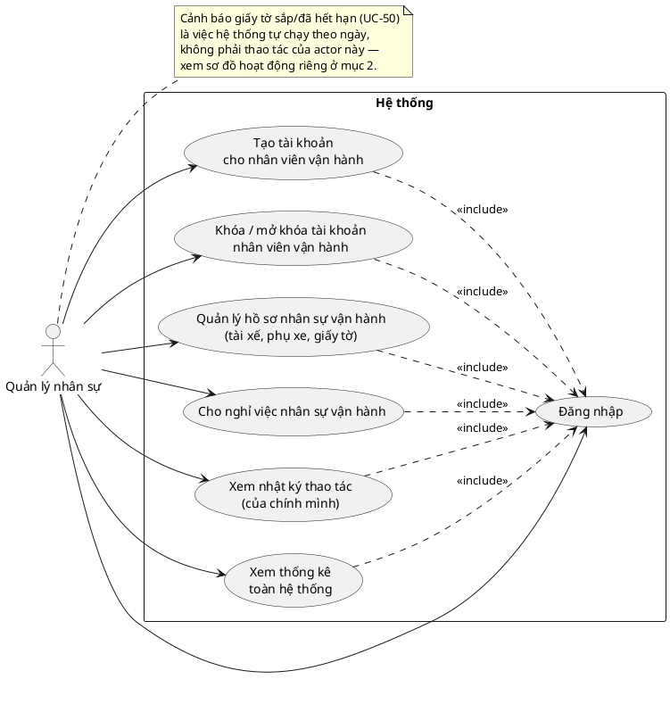

# Nghiệp vụ Quản lý nhân sự (`quan_ly_nhan_su`) — tổng hợp để đọc nhanh

> **Cập nhật 23/10/2026 — UC-36 bỏ cơ chế mời bằng OTP.** Email cán bộ do công ty cấp nên không cần xác minh. Khi tạo, tài khoản có mật khẩu ban đầu mặc định `12345678` (lưu bản băm; response trả `mat_khau_ban_dau` để nhắc người tạo) và **không gửi email**; cán bộ đổi mật khẩu sau khi đăng nhập. OTP chỉ dùng khi quên mật khẩu. Mọi chỗ bên dưới nhắc "mời/OTP/`da_gui_email`/mail lỗi" cho UC-36 là **bản cũ**; bản đúng ở `NGHIEP_VU.md` UC-36 và `KE_HOACH_UC36_TAO_TAI_KHOAN_CAN_BO.md` mục 2.4. Giữ lại `da_xac_nhan = true` lúc tạo (`dang_nhap` chặn mọi tài khoản chưa xác nhận).

> **File này không phải tài liệu gốc.** Nó **gom 1 chỗ** mọi thứ liên quan tới `quan_ly_nhan_su` trong `NGHIEP_VU.md`, `UML_DIAGRAMS.md`, `DATABASE.md`, `ARCHITECTURE.md`, `CONTRIBUTING.md` (nhánh `integration/gop-nhanh-thanh-vien`) để đọc cho nhanh. Nếu lệch, **file gốc luôn đúng hơn**.
>
> Phạm vi hồ sơ: **chỉ tài xế và phụ xe**. Đề xuất mở rộng sang hồ sơ cán bộ văn phòng đã được cân nhắc và **không làm** — lý do ở mục 2.3, ghi chép ở mục 12.

---

## 0. Tóm tắt nhanh

| | |
|---|---|
| **Use case liên quan** | UC-36, UC-37 (gộp UC-38 cũ), UC-39, UC-49 (gộp UC-50 cũ), UC-51, UC-52 |
| **Actor** | Quản lý nhân sự, và Quản lý (làm được mọi UC trên, trừ UC-52 khác phạm vi 1 chút) |
| **Trạng thái tài liệu** | ✅ Đã chốt chính thức; các chỗ làm rõ UC-36/37/51/52 đã ghi vào `NGHIEP_VU.md`/`UML_DIAGRAMS.md` (mục 11.1) |
| **Trạng thái code** | ✅ UC-49 đã xong (backend + frontend, chưa có test tự động). ❌ UC-36, UC-37, UC-51, UC-52 **chưa có** |
| **Bảng DB liên quan** | `nhan_su_van_hanh` (mở rộng), `giay_to_nhan_su` (mới), `nhat_ky_quan_ly_nhan_su` (mới) — cả 3 đã có migration |
| **Quyết định kiến trúc đi kèm** | Dùng lại **Cloudinary** để lưu ảnh hồ sơ/giấy tờ (mục 9) |

---

## 1. Phạm vi & ranh giới (`NGHIEP_VU.md` mục 8.9)

> Phạm vi **toàn hệ thống** (không gắn văn phòng, giống `ke_toan`/`quan_ly`, mục 2) — sinh ra để san bớt việc quản lý nhân sự vận hành khỏi `quan_ly` khi quy mô công ty lớn (nhiều văn phòng, hàng trăm nhân sự). Chỉ xử lý **tài khoản và hồ sơ** nhân sự cấp vận hành — **không có quyền nghiệp vụ nào khác** (không sửa tuyến, giá, xe, biên chế xe, khuyến mãi, lịch chạy định kỳ).

1. **Tạo tài khoản** cho đúng **4 vai trò**: `nhan_vien_van_hanh` (phụ xe; trong DB/code là `phu_xe`), `nhan_vien_quay_ve`, `nhan_vien_gui_hang`, `dieu_do_vien` — qua cơ chế mời như `quan_ly`. **Không** tạo được `ke_toan`, `quan_ly`, hay `quan_ly_nhan_su` khác.
2. **Khóa/mở khóa tài khoản** cho đúng 4 vai trò trên — không đụng được `ke_toan`/`quan_ly`/`quan_ly_nhan_su` khác.
3. Xem thống kê toàn hệ thống (UC-39), cùng phạm vi như `quan_ly`.
4. Chỉ **tài khoản `quan_ly` gốc** mới tạo được `quan_ly_nhan_su` — không tự đăng ký, không được `quan_ly_nhan_su` khác hay `quan_ly` không phải gốc tạo hộ.
5. **Quản lý hồ sơ nhân sự vận hành** (UC-49): tạo/sửa hồ sơ **tài xế và phụ xe** (họ tên, SĐT, CCCD, ngày sinh, ngày vào làm) kèm **giấy tờ** (bằng lái, giấy khám sức khỏe, ngày hết hạn). Tài xế không có tài khoản nên đây là nơi duy nhất lưu thông tin của họ. Hệ thống tự nhắc khi giấy tờ sắp hết hạn.
6. **Cho nghỉ việc** nhân sự vận hành (UC-51): đóng hồ sơ (không xóa, giữ lịch sử), khóa tài khoản nếu là phụ xe, và **báo ngay** cho `quan_ly` + điều độ viên biết xe nào vừa thiếu người để bổ sung. Quản lý nhân sự **không** tự gỡ/thay biên chế xe — đó là việc của `quan_ly` (UC-35).
7. Xem **nhật ký thao tác của chính mình** (UC-52) — mọi thao tác tạo/khóa/mở khóa tài khoản, tạo/sửa hồ sơ, cho nghỉ việc đều được ghi lại. `quan_ly` xem được nhật ký của mọi người.

> **Ranh giới với `quan_ly`**: quản lý nhân sự trả lời "**ai** là nhân sự của công ty, giấy tờ còn hạn không" (hồ sơ); `quan_ly` trả lời "người đó **đi xe nào**" (biên chế, UC-35). `quan_ly` làm được cả hai; quản lý nhân sự chỉ làm phần hồ sơ.

### Quan hệ với biên chế xe (`NGHIEP_VU.md` mục 3.2)

> **Hồ sơ nhân sự vận hành (`nhan_su_van_hanh`) và biên chế (`xe_nhan_su`) do 2 vai trò khác nhau quản lý**: hồ sơ do `quan_ly_nhan_su` hoặc `quan_ly`; biên chế cố định do `quan_ly` (UC-35). **Chỉ hồ sơ đang làm việc (`dang_lam`) mới được đưa vào biên chế xe.** Giấy tờ hết hạn **không chặn** việc biên chế hay gán xe — hệ thống chỉ nhắc, quyết định cuối cùng là của con người.

---

## 2. Thứ bậc vai trò & phạm vi quản lý (tài khoản và hồ sơ)

### 2.1. Thứ bậc

| Cấp | Vai trò | Ghi chú |
|---|---|---|
| 1 | `quan_ly` **gốc** | Duy nhất, seed sẵn, không ai khóa được; duy nhất tạo được `quan_ly` khác và `quan_ly_nhan_su` |
| 2 | `quan_ly` (tạo thêm) | Toàn quyền nghiệp vụ như gốc, trừ 2 việc trên; có thể bị khóa |
| 3 | `quan_ly_nhan_su` | Chỉ tài khoản + hồ sơ nhân sự; không có quyền nghiệp vụ khác |
| 4 | `ke_toan` | Ngang mức cấp 3 nhưng khác nhánh; chỉ xử lý hoàn tiền |
| 5 | Cán bộ vận hành: phụ xe, quầy vé, gửi hàng, điều độ viên | Không quản lý tài khoản của ai |
| 6 | `khach_hang` | Tự đăng ký công khai |
| — | Tài xế | **Không có tài khoản**, chỉ có hồ sơ trong `nhan_su_van_hanh` |

Nguyên tắc: vai trò càng nhạy cảm (tiền, quyền quản trị) thì càng ít người tạo/khóa được — để một tài khoản cấp cao bị lộ cũng không tự sinh/tác động lên tài khoản ngang hàng.

### 2.2. Quản lý nhân sự quản lý được gì — theo từng vai trò

| Vai trò bị quản lý | Tài khoản (UC-36/37) | Hồ sơ | Cho nghỉ việc (UC-51) |
|---|---|---|---|
| Tài xế | — (không có tài khoản) | ✅ xem/tạo/sửa (UC-49) | ✅ (+ báo biên chế) |
| Phụ xe (`phu_xe`) | ✅ | ✅ xem/tạo/sửa (UC-49) | ✅ (+ khóa tài khoản + báo biên chế) |
| `nhan_vien_quay_ve` | ✅ | ❌ (chỉ có tài khoản) | khóa tài khoản (UC-37) |
| `nhan_vien_gui_hang` | ✅ | ❌ (chỉ có tài khoản) | khóa tài khoản (UC-37) |
| `dieu_do_vien` | ✅ | ❌ (chỉ có tài khoản) | khóa tài khoản (UC-37) |
| `ke_toan` | ❌ | ❌ | ❌ |
| `quan_ly_nhan_su` khác | ❌ | ❌ | ❌ |
| `quan_ly` | ❌ | ❌ | ❌ |
| `khach_hang` | tài liệu chưa nêu cho QLNS (UC-37 nói "khách hàng hoặc cán bộ" — cần làm rõ) | ❌ | ❌ |

### 2.3. Vì sao hồ sơ chỉ có tài xế và phụ xe

- Dữ liệu của tài xế/phụ xe **ảnh hưởng trực tiếp tới vận hành**: biên chế xe chỉ nhận hồ sơ đang làm; giấy tờ có hạn cần nhắc để xe chạy an toàn, đúng luật; nghỉ việc phải báo xe nào thiếu người. Tài xế **không có tài khoản** nên hệ thống là nơi duy nhất có thông tin của họ.
- Các vai trò khác hệ thống **đã có đủ thứ cần dùng**: tài khoản (họ tên, SĐT, email, vai trò), văn phòng phụ trách (`ho_so_can_bo_diem`), trạng thái khóa. CCCD, ngày sinh, ngày vào làm của họ **không được nghiệp vụ nào dùng tới**.
- Đây là **dữ liệu cá nhân nhạy cảm**: không dùng thì không giữ, đỡ phải bảo vệ.
- Nhất quán với quyết định không đưa hợp đồng, BHXH, lương... vào hệ thống — đó là việc của phòng nhân sự, lưu ở ngoài.
- Nghỉ việc của nhân viên quầy vé / gửi hàng / điều độ viên xử lý bằng **UC-37 (khóa tài khoản)**.

---

## 3. Bảng vai trò (`NGHIEP_VU.md` mục 2)

| Vai trò | Ai tạo được | Làm được gì |
|---|---|---|
| `quan_ly_nhan_su` | Được **quản lý gốc** tạo trực tiếp, **không gắn văn phòng nào** (phạm vi toàn hệ thống) | Tạo/khóa/mở khóa tài khoản cho `nhan_vien_van_hanh` (phụ xe), `nhan_vien_quay_ve`, `nhan_vien_gui_hang`, `dieu_do_vien` — **không** quản lý tài khoản `ke_toan`, `quan_ly`, hay `quan_ly_nhan_su` khác. **Quản lý hồ sơ nhân sự vận hành** (tài xế + phụ xe: thông tin, giấy tờ, cho nghỉ việc). Xem nhật ký thao tác của chính mình. Xem thống kê toàn hệ thống. Không có quyền nghiệp vụ nào khác (tuyến, giá, xe, **biên chế xe**, khuyến mãi) |

---

## 4. Ma trận quyền (`NGHIEP_VU.md` mục 11)

Cột theo thứ tự: khách hàng · phụ xe · tài xế · quầy vé · gửi hàng · điều độ viên · kế toán · **quản lý nhân sự** · **quản lý**

| UC | Tên | QLNS | QL |
|---|---|---|---|
| UC-35 | Quản lý biên chế xe | ❌ | ✅ |
| UC-36 | Tạo tài khoản cán bộ | ✅ (4 vai trò vận hành, không `ke_toan`/`quan_ly`/`quan_ly_nhan_su`) | ✅ (mọi vai trò; `quan_ly`/`quan_ly_nhan_su` chỉ tài khoản gốc tạo được) |
| UC-37 | Khóa / mở khóa tài khoản *(gộp từ UC-37 + UC-38 cũ)* | ✅ (4 vai trò vận hành) | ✅ (mọi tài khoản; riêng `quan_ly` gốc không ai khóa được) |
| UC-39 | Xem thống kê doanh thu/vận hành | ✅ (toàn hệ thống) | ✅ (toàn hệ thống) |
| **UC-49** | **Quản lý hồ sơ nhân sự vận hành (tài xế/phụ xe)** *(gồm cơ chế UC-50 cũ — cảnh báo giấy tờ)* | ✅ | ✅ |
| **UC-51** | **Cho nghỉ việc nhân sự vận hành** | ✅ | ✅ |
| **UC-52** | **Xem nhật ký thao tác** | ✅ (của mình) | ✅ (toàn bộ) |

---

## 5. Đặc tả use case (`NGHIEP_VU.md` mục 12)

### UC-49. Quản lý hồ sơ nhân sự vận hành (tài xế/phụ xe) *(gồm cơ chế UC-50 cũ)*

- **Actor**: Quản lý nhân sự, hoặc Quản lý.
- **Tiền điều kiện**: Với hồ sơ phụ xe: tài khoản `phu_xe` đã được tạo (UC-36). Tài xế không cần tài khoản.
- **Luồng chính**:
  1. Chọn "Thêm hồ sơ", hoặc chọn 1 hồ sơ có sẵn để sửa.
  2. Nhập họ tên, số điện thoại, chức danh (`tai_xe`/`phu_xe`), số CCCD, ngày sinh, ngày vào làm; nếu là phụ xe thì chọn tài khoản `phu_xe` tương ứng.
  3. Nhập/cập nhật giấy tờ: bằng lái và giấy khám sức khỏe — mỗi giấy tờ gồm số, hạng (chỉ bằng lái), ngày cấp, ngày hết hạn (ảnh giấy tờ upload riêng sau khi đã lưu). Bằng lái **bắt buộc với tài xế**, không bắt buộc với phụ xe.
  4. Hệ thống kiểm tra, lưu hồ sơ và ghi nhật ký thao tác (UC-52).
- **Luồng rẽ nhánh**:
  - Chức danh `phu_xe` nhưng tài khoản được chọn không phải vai trò `phu_xe`, hoặc đã gắn với hồ sơ khác → chặn, báo lỗi → chọn lại.
  - Chức danh `tai_xe` mà có chọn tài khoản → chặn (tài xế không có tài khoản).
  - Hồ sơ `tai_xe` chưa có bằng lái → chặn, báo "tài xế bắt buộc có thông tin bằng lái".
  - Ngày hết hạn đã qua → **vẫn cho lưu**, hệ thống hiển thị cờ "đã hết hạn".
  - Gia hạn giấy tờ (nhập ngày hết hạn mới) → hệ thống xóa cờ đã cảnh báo, chu kỳ nhắc bắt đầu lại từ đầu.
  - Không có thao tác xóa hồ sơ, không đổi chức danh sau khi tạo; nhân sự thôi việc dùng UC-51.
- **Hậu điều kiện**: Hồ sơ đầy đủ; nhân sự đang làm việc có thể được `quan_ly` đưa vào biên chế xe (UC-35).

#### Nhánh kèm theo — trước đây là UC-50 (Tự động cảnh báo giấy tờ sắp/đã hết hạn)

- **Actor**: Hệ thống (job định kỳ).
- **Tiền điều kiện**: Hồ sơ `dang_lam` có giấy tờ với ngày hết hạn còn ≤ 30 ngày (ngưỡng `quan_ly` cấu hình) hoặc đã qua.
- **Luồng chính**:
  1. Job quét giấy tờ của toàn bộ nhân sự đang làm việc, mỗi ngày 1 lần.
  2. Giấy tờ còn ≤ 30 ngày mà chưa có cờ "đã cảnh báo sắp hết hạn" → bật cờ, gửi thông báo tới mọi tài khoản `quan_ly_nhan_su` đang hoạt động.
  3. Giấy tờ đã qua ngày hết hạn mà chưa có cờ "đã cảnh báo hết hạn" → bật cờ, gửi thông báo mức khẩn.
- **Luồng rẽ nhánh**:
  - Không có tài khoản `quan_ly_nhan_su` nào đang hoạt động → gửi cho `quan_ly`.
  - Nhân sự đã `da_nghi_viec` → bỏ qua.
  - Giấy tờ được gia hạn → 2 cờ được xóa, quay lại chu kỳ cảnh báo từ đầu.
  - Không có nhánh nào tự khóa tài khoản, tự gỡ biên chế hay chặn gán xe — chỉ **nhắc con người xử lý**.
- **Hậu điều kiện**: Người quản lý nhân sự nhận được nhắc; hồ sơ và biên chế giữ nguyên, chờ xử lý thủ công.

### UC-51. Cho nghỉ việc nhân sự vận hành

- **Actor**: Quản lý nhân sự, hoặc Quản lý.
- **Tiền điều kiện**: Hồ sơ đang `dang_lam`. Chỉ áp dụng cho nhân sự vận hành (tài xế, phụ xe); tài khoản quầy vé/gửi hàng/điều độ viên nghỉ việc thì dùng UC-37 (khóa tài khoản).
- **Luồng chính**:
  1. Chọn hồ sơ cần cho nghỉ việc, nhập ngày nghỉ và lý do (ngày nghỉ mặc định hôm nay, không ở tương lai, không trước ngày vào làm; lý do bắt buộc — mục 11.1).
  2. Hệ thống liệt kê các dòng biên chế `xe_nhan_su` mà người này đang thuộc, kèm xe nào sẽ **thiếu người** sau khi họ nghỉ (so với quy tắc 2 tài xế + ≥1 phụ xe cố định mỗi xe).
  3. Người thao tác xem cảnh báo và xác nhận.
  4. Hệ thống: đặt hồ sơ `da_nghi_viec` (kèm ngày, lý do); nếu là phụ xe thì khóa tài khoản (`dang_hoat_dong = false`); chuyển mọi dòng `xe_nhan_su` của người này sang `tam_nghi`.
  5. Hệ thống gửi thông báo tới `quan_ly` (gỡ hẳn/biên chế người mới) và các điều độ viên (dùng nguồn dự phòng tạm thời), nêu rõ xe nào đang thiếu người.
  6. Ghi nhật ký thao tác (UC-52).
- **Luồng rẽ nhánh**:
  - Hồ sơ đã `da_nghi_viec` → chặn.
  - Xe mà người này thuộc biên chế đang có chuyến `dang_chay` → chặn, báo "chờ chuyến kết thúc rồi thực hiện lại" → kết thúc.
  - Người này không thuộc biên chế xe nào → bỏ qua bước 2 và 5, chuyển thẳng sang bước 4.
  - Hệ thống **không xóa cứng** hồ sơ và **không tự gỡ** dòng biên chế cố định — việc gỡ hẳn và biên chế người mới thuộc `quan_ly` (UC-35).
- **Hậu điều kiện**: Hồ sơ `da_nghi_viec` (giữ lịch sử); tài khoản phụ xe (nếu có) không đăng nhập được; các xe bị ảnh hưởng đã được báo cho `quan_ly` và điều độ viên.

### UC-52. Xem nhật ký thao tác

- **Actor**: Quản lý nhân sự (chỉ thấy các dòng do chính mình thực hiện), hoặc Quản lý (thấy toàn bộ).
- **Luồng chính**:
  1. Mở màn hình nhật ký.
  2. Lọc theo khoảng thời gian, loại hành động, đối tượng bị tác động; riêng `quan_ly` lọc thêm được theo người thực hiện.
  3. Hệ thống hiển thị danh sách, dòng mới nhất trước.
- **Luồng rẽ nhánh**: Nhật ký **chỉ xem** — không có thao tác sửa hay xóa dòng nào.
- **Hậu điều kiện**: Không thay đổi dữ liệu.

### UC-36. Tạo tài khoản cán bộ *(dùng chung với `quan_ly`)*

- **Actor**: Quản lý (bất kỳ, gốc hay không), hoặc Quản lý nhân sự (phạm vi hẹp hơn).
- **Luồng chính**:
  1. Nhập email + vai trò muốn tạo + văn phòng phụ trách (bắt buộc trừ `ke_toan`/`quan_ly`/`quan_ly_nhan_su`).
  2. Hệ thống kiểm tra actor có quyền tạo đúng vai trò vừa chọn hay không.
  3. Hệ thống tạo tài khoản trạng thái "chưa đặt mật khẩu", gửi email mời.
  4. Cán bộ nhận email, bấm liên kết, tự đặt mật khẩu lần đầu.
- **Luồng rẽ nhánh**:
  - Email đã tồn tại → báo lỗi → nhập lại.
  - Actor là `quan_ly_nhan_su` nhưng vai trò muốn tạo là `ke_toan`/`quan_ly`/`quan_ly_nhan_su` → chặn, báo "không đủ quyền".
  - Actor là `quan_ly` không phải tài khoản gốc nhưng vai trò muốn tạo là `quan_ly`/`quan_ly_nhan_su` → chặn.
- **Hậu điều kiện**: Cán bộ có tài khoản, đăng nhập được (UC-02).

### UC-37. Khóa / mở khóa tài khoản *(gộp từ UC-37 + UC-38 cũ, dùng chung với `quan_ly`)*

- **Actor**: Quản lý (bất kỳ), hoặc Quản lý nhân sự (phạm vi hẹp hơn).
- **Luồng chính (khóa)**:
  1. Tìm tài khoản (khách hàng hoặc cán bộ) cần khóa.
  2. Hệ thống kiểm tra actor có quyền khóa đúng tài khoản mục tiêu hay không.
  3. Nhập lý do (nếu có).
  4. Đặt `dang_hoat_dong = false`.
- **Luồng rẽ nhánh**:
  - Tài khoản mục tiêu là `quan_ly` gốc → chặn tuyệt đối, không ai khóa được.
  - Actor là `quan_ly_nhan_su` nhưng mục tiêu là `ke_toan`/`quan_ly`/`quan_ly_nhan_su` khác → chặn.
- **Hậu điều kiện**: Tài khoản không đăng nhập được nữa; lịch sử vẫn được giữ. **Nếu tài khoản bị khóa là `phu_xe` đang thuộc biên chế xe**, hệ thống cảnh báo "xe X thiếu phụ xe" và gửi thông báo như UC-51 — nhưng **không tự đổi biên chế** (khóa tạm thời chưa chắc là nghỉ việc; nếu là nghỉ việc thì dùng UC-51).

#### Nhánh kèm theo — trước đây là UC-38 (Mở khóa tài khoản)

- **Luồng chính**: Tìm tài khoản đang khóa → kiểm tra quyền (cùng quy tắc UC-37) → xem lý do bị khóa trước đó → đặt lại `dang_hoat_dong = true`.
- **Luồng rẽ nhánh**: Actor là `quan_ly_nhan_su` nhưng tài khoản mục tiêu là `ke_toan`/`quan_ly`/`quan_ly_nhan_su` khác → chặn.
- **Hậu điều kiện**: Tài khoản đăng nhập lại được.

### UC-35. Quản lý biên chế xe *(chỉ `quan_ly` — ghi lại đoạn liên quan tới hồ sơ nhân sự)*

- **Luồng rẽ nhánh (bổ sung)**: Tại bước chọn nhân sự đưa vào biên chế: hồ sơ đang `da_nghi_viec` → chặn, **chỉ hồ sơ `dang_lam` mới được biên chế**.

---

## 6. Sơ đồ use case (`UML_DIAGRAMS.md` mục 1.8)



> Sơ đồ "Quản lý" (mục 1.6) cũng có đủ UC-36, UC-37, UC-49, UC-51, UC-52 — vì `quan_ly` làm được mọi UC của `quan_ly_nhan_su`.

---

## 7. Thiết kế database

### 7.1. `nhan_su_van_hanh` (`DATABASE.md` mục 1.4 — bảng cũ, mở rộng thêm)

| Cột | Kiểu | Ghi chú |
|---|---|---|
| `id` | UUID PK | |
| `ho_ten` | TEXT NOT NULL | |
| `so_dien_thoai` | TEXT NOT NULL | |
| `chuc_danh` | TEXT NOT NULL, CHECK IN (`tai_xe`, `phu_xe`) | |
| `nguoi_dung_id` | UUID NULLABLE, FK → `nguoi_dung(id)` | Chỉ có giá trị khi `chuc_danh = 'phu_xe'` |
| `so_cccd` | TEXT NULLABLE | Dữ liệu nhạy cảm — chỉ `quan_ly_nhan_su`/`quan_ly` đọc được. `UNIQUE` khi khác `NULL` |
| `ngay_sinh` | DATE NULLABLE | |
| `anh_ho_so` | TEXT NULLABLE | `public_id` ảnh trên Cloudinary (**không lưu URL**) |
| `ngay_vao_lam` | DATE NOT NULL DEFAULT current_date | |
| `trang_thai` | TEXT NOT NULL DEFAULT `'dang_lam'`, CHECK IN (`dang_lam`, `da_nghi_viec`) | Trạng thái làm việc của cả hồ sơ — khác `xe_nhan_su.trang_thai`. `da_nghi_viec` không được đưa vào biên chế mới và bị job cảnh báo bỏ qua |
| `ngay_nghi_viec` | DATE NULLABLE | Chỉ có giá trị khi `trang_thai = 'da_nghi_viec'` |
| `ly_do_nghi_viec` | TEXT NULLABLE | |

Ràng buộc DB: `UNIQUE (nguoi_dung_id)`; `CHECK (chuc_danh = 'phu_xe' OR nguoi_dung_id IS NULL)`; `CHECK ((trang_thai = 'da_nghi_viec') = (ngay_nghi_viec IS NOT NULL))`. Tài khoản gắn cho hồ sơ phụ xe phải có `nguoi_dung.vai_tro = 'phu_xe'` — kiểm tra ở Service.

### 7.2. `giay_to_nhan_su` (`DATABASE.md` mục 1.6 — bảng mới)

Mỗi nhân sự tối đa **1 dòng cho mỗi loại giấy tờ** — gia hạn thì cập nhật dòng đó.

| Cột | Kiểu | Ghi chú |
|---|---|---|
| `id` | UUID PK | |
| `nhan_su_van_hanh_id` | UUID NOT NULL, FK → `nhan_su_van_hanh(id)` | |
| `loai` | TEXT NOT NULL, CHECK IN (`bang_lai`, `giay_kham_suc_khoe`) | `UNIQUE (nhan_su_van_hanh_id, loai)` |
| `so_giay_to` | TEXT NULLABLE | |
| `hang` | TEXT NULLABLE | Chỉ dùng cho `bang_lai` (VD D, E) |
| `ngay_cap` | DATE NULLABLE | |
| `ngay_het_han` | DATE NOT NULL | Mốc để job cảnh báo quét |
| `anh_giay_to` | TEXT NULLABLE | `public_id` Cloudinary, cùng cách lưu với `anh_ho_so` |
| `da_canh_bao_sap_het_han` | BOOLEAN NOT NULL DEFAULT false | |
| `da_canh_bao_het_han` | BOOLEAN NOT NULL DEFAULT false | |

Gia hạn phải đặt lại **cả 2 cờ về `false`**. Index: `giay_to_nhan_su(ngay_het_han)`.

### 7.3. `nhat_ky_quan_ly_nhan_su` (`DATABASE.md` mục 6.3 — bảng mới, **tách riêng khỏi `nhat_ky_admin`**)

Chỉ ghi hành động do chính `quan_ly_nhan_su` thực hiện — không lẫn hành động của `quan_ly` hay vai trò khác, kể cả khi 2 vai trò cùng làm 1 việc giống nhau.

| Cột | Kiểu | Ghi chú |
|---|---|---|
| `id` | UUID PK | |
| `quan_ly_nhan_su_id` | UUID NOT NULL, FK → `nguoi_dung(id)` | Phải có `vai_tro = 'quan_ly_nhan_su'` — kiểm tra ở Service |
| `hanh_dong` | TEXT NOT NULL, CHECK IN (`tao_tai_khoan`, `khoa_tai_khoan`, `mo_khoa_tai_khoan`, `tao_ho_so_nhan_su`, `sua_ho_so_nhan_su`, `cho_nghi_viec`) | |
| `doi_tuong_loai` | TEXT NOT NULL, CHECK IN (`nguoi_dung`, `nhan_su_van_hanh`) | |
| `doi_tuong_id` | UUID NOT NULL | |
| `ghi_chu` | TEXT NULLABLE | VD lý do khóa, lý do nghỉ việc |
| `thoi_gian` | TIMESTAMPTZ NOT NULL DEFAULT now() | |

Quy ước: bảng **chỉ `INSERT`**, ghi trong **cùng transaction** với thao tác nghiệp vụ. Index: `(quan_ly_nhan_su_id, thoi_gian DESC)` và `(doi_tuong_loai, doi_tuong_id, thoi_gian DESC)`.

### 7.4. Lưu ý khác (`DATABASE.md` mục 9)

- **Phân quyền đọc**: `so_cccd`, `ngay_sinh`, `giay_to_nhan_su` (số giấy tờ, ảnh) là dữ liệu nhạy cảm — chỉ `quan_ly_nhan_su`/`quan_ly` đọc được; ảnh phát qua URL có chữ ký, không lưu URL cố định.
- **Ngưỡng cảnh báo giấy tờ (mặc định 30 ngày)**: chưa có bảng cấu hình tham số, tạm để hằng số `NGUONG_CANH_BAO_GIAY_TO_NGAY` trong `backend/app/config.py`.
- **Cho nghỉ việc (UC-51) chạy trong 1 transaction**: đặt `trang_thai` hồ sơ, khóa `nguoi_dung.dang_hoat_dong` (nếu là phụ xe), chuyển `xe_nhan_su.trang_thai` sang `tam_nghi`, ghi `nhat_ky_quan_ly_nhan_su` — tất cả cùng thành công hoặc không làm gì.

---

## 8. API

### 8.1. Đã có (UC-49, `backend/app/routes/nhan_su.py`, prefix `/quan-ly-nhan-su`)

```
GET    /quan-ly-nhan-su/ho-so?chi_dang_lam=true
GET    /quan-ly-nhan-su/tai-khoan-phu-xe-chua-gan
GET    /quan-ly-nhan-su/ho-so/{id}
POST   /quan-ly-nhan-su/ho-so
PUT    /quan-ly-nhan-su/ho-so/{id}
POST   /quan-ly-nhan-su/ho-so/{id}/anh
POST   /quan-ly-nhan-su/ho-so/{id}/giay-to/{loai}/anh
```

### 8.2. Frontend (`frontend/nhan-vien/quan-li-nhan-su/`)

- **Đã có**: `trang-chu.html` (tổng quan), `ho-so.html` (danh sách + modal thêm/sửa hồ sơ tài xế/phụ xe, chọn tài khoản phụ xe, upload ảnh hồ sơ và ảnh giấy tờ, nhãn hạn giấy tờ), `nav.js`, `api-client.js`, `auth-check.js`. Dùng chung `/nhan-vien/quan-ly/style.css` và `data-table.js` bằng tham chiếu.

---

## 9. Quyết định kiến trúc: Cloudinary (`ARCHITECTURE.md` mục 1)

> | File/ảnh | **Cloudinary**, chỉ cho ảnh hồ sơ nhân sự vận hành (ảnh chân dung, bằng lái, giấy khám sức khỏe — `quan_ly_nhan_su`, `services/luu_tru_anh_service.py`) | Khách/nhân viên không upload ảnh; vé và biên nhận gửi hàng vẫn in trực tiếp tại quầy. Ảnh nhân sự cần lưu ngoài ổ đĩa backend (Render free tier mất dữ liệu khi redeploy); DB chỉ lưu `public_id`, ảnh phát bằng URL có chữ ký (delivery `authenticated`) vì là giấy tờ nhạy cảm |


---

## 10. Phân công (`CONTRIBUTING.md`)

UC-49, UC-51, UC-52 (vai trò `quan_ly_nhan_su`) **chưa phân công người** trong tài liệu — hiện là việc của bạn. UC-36, UC-37: chưa rõ ai làm (xem mục 11).

---

## 11. Code đã có / còn thiếu

**Đã có:**
- Migration `20260927_1000_tao_bang_nhan_su_van_hanh_giay_to_nhat_ky.sql` — tạo `giay_to_nhan_su`, `nhat_ky_quan_ly_nhan_su`, mở rộng `nhan_su_van_hanh`.
- **UC-49 backend** (đã test qua Swagger/PowerShell): `routes/nhan_su.py`, `schemas/nhan_su_schema.py`, `services/ho_so_nhan_su_service.py`, `repositories/giay_to_nhan_su_repository.py`, `repositories/nhat_ky_quan_ly_nhan_su_repository.py`, các hàm hồ sơ thêm cuối `repositories/nhan_su_van_hanh_repository.py`, job `jobs/canh_bao_giay_to.py` (chạy mỗi 24 giờ, đăng ký trong `main.py`), hằng số ngưỡng trong `config.py`, `services/luu_tru_anh_service.py`.
- **UC-49 frontend** (viết xong, chưa test kỹ trên trình duyệt): `trang-chu.html`, `ho-so.html` và các file hỗ trợ.
- `frontend/nhan-vien/dang-nhap.html`: `quan_ly_nhan_su` chuyển tới `/nhan-vien/quan-li-nhan-su/trang-chu.html` (đổi 1 giá trị, báo nhóm khi ghép).

**Chưa có — cần viết:**
- **UC-36, UC-37** cho `quan_ly_nhan_su` (tạo / khóa / mở khóa tài khoản 4 vai trò) — chưa thấy route; cần xác nhận với nhóm ai đang làm. Làm xong sẽ thay ô nhập tay tài khoản phụ xe bằng danh sách thật.
- **UC-51** (cho nghỉ việc) và **UC-52** (xem nhật ký): backend + frontend; mục ghi nhật ký (`ghi`) đã có sẵn nhưng chưa có hàm đọc.
- Test tự động cho `ho_so_nhan_su_service.py`.
- Lỗi hiển thị Swagger UI với tham số header tùy chọn (`str | None`) — chưa sửa, đã biết cách né bằng PowerShell/curl.

### 11.1. Thiết kế triển khai UC-36 / UC-37 / UC-51 / UC-52 *(đã rà code, CHƯA viết code)*

> Đây là bản thiết kế để làm khi bắt đầu code. Các quyết định đã rà với code hiện có; chỗ nào làm rõ spec đã được ghi vào `NGHIEP_VU.md` / `UML_DIAGRAMS.md` (xem cuối mục).

#### a) Code hiện có có thể tái dùng

| Cần | Đã có | Ghi chú |
|---|---|---|
| Bảng tài khoản | `nguoi_dung` — `mat_khau` cho phép NULL, có `la_tai_khoan_goc`, `dang_hoat_dong` | Tài khoản gốc đã seed sẵn |
| Gán văn phòng cho cán bộ | `nguoi_dung_repository.gan_van_phong` + bảng `ho_so_can_bo_diem` (chỉ lưu văn phòng phụ trách, không phải hồ sơ nhân sự) | Chỉ áp dụng quầy vé / gửi hàng (điều độ viên không còn gắn văn phòng — nhóm đã duyệt) |
| Gửi OTP qua email, đặt mật khẩu lần đầu | `mat_khau_service.quen_mat_khau` + `dat_lai_mat_khau`, trang `quen-mat-khau.html` | Hạn mã **1 phút** |
| Danh sách văn phòng | bảng `diem_don_tra` với `loai = 'van_phong'` | Chưa có API cho `quan_ly_nhan_su` (API cũ khóa vai trò `quan_ly`) |
| Thông báo nội bộ | `thong_bao_khach_service.gui` (lưu DB + đẩy real-time, nuốt lỗi) | Dùng được cho mọi `nguoi_dung` |
| Biên chế | `xe_nhan_su` (`loai`: `co_dinh`/`tam_thoi`; `trang_thai`: `dang_hoat_dong`/`tam_nghi`), `chuyen_xe` (`xe_id`, `xe_thuc_te_id`) | Đủ để tính xe thiếu người và xe đang chạy |
| Ghi nhật ký | `nhat_ky_quan_ly_nhan_su_repository.ghi` | **Chưa có hàm đọc** — UC-52 phải thêm |

`ARCHITECTURE.md` đã dự kiến sẵn tên `services/tai_khoan_can_bo_service.py` và `routes/tai_khoan_can_bo.py` cho UC-36/37 — đặt đúng tên này.

#### b) Quyết định thiết kế

| # | Vấn đề | Quyết định | Ghi vào tài liệu gốc |
|---|---|---|---|
| 1 | Thông tin nhập khi tạo tài khoản | Email + **họ tên + SĐT** + vai trò (+ văn phòng). Họ tên/SĐT bắt buộc vì cột `NOT NULL`; SĐT chuẩn hóa bằng `chuan_hoa_so_dien_thoai` | ✅ UC-36 bước 1, UML UC-36 |
| 2 | Vai trò nào cần văn phòng | Chỉ **quầy vé / gửi hàng**. Phụ xe, điều độ viên, kế toán, quản lý, QLNS không gắn văn phòng (bản cũ ghi "bắt buộc trừ kế toán/quản lý/QLNS" — vô tình gồm phụ xe; điều độ viên bỏ văn phòng theo đề xuất theo tuyến đã được nhóm duyệt) | ✅ UC-36 bước 1, mục 2 và 8.7 |
| 3 | Cơ chế "thư mời" | Tạo `nguoi_dung` với `mat_khau = NULL`, `da_xac_nhan = true`, rồi gọi `quen_mat_khau(email)` để gửi OTP. Cán bộ đặt mật khẩu ở trang **Quên mật khẩu** (không có liên kết riêng). Không viết lại email | ✅ UC-36 bước 3-4, UML UC-36 |
| 4 | Gửi mail lỗi | Tài khoản **vẫn tạo**, API trả cờ `da_gui_email = false` để người tạo báo cán bộ tự dùng Quên mật khẩu | ✅ UC-36 rẽ nhánh |
| 5 | Thứ tự kiểm tra khi tạo | Quyền → định dạng SĐT → email trùng → văn phòng hợp lệ → mới tạo (kiểm tra hết trước khi ghi để không tạo dở) | — |
| 6 | Tự khóa chính mình | **Chặn** (tránh tự mất quyền truy cập) | ✅ UC-37 rẽ nhánh, UML UC-37 |
| 7 | Khóa phụ xe đang trong biên chế | Trả danh sách xe thiếu người cho người thao tác + gửi thông báo, **không tự đổi biên chế** (đúng UC-37). Dùng chung hàm tính "xe thiếu người" với UC-51 | — (đã có trong spec) |
| 8 | Mở khóa — xem lại lý do khóa | Trả lý do ở lần khóa gần nhất **nếu do QLNS khóa** (bảng nhật ký chỉ có hành động QLNS — xem mục e) | — |
| 9 | UC-51: nhập liệu | Ngày nghỉ mặc định hôm nay, không tương lai, không trước ngày vào làm; **lý do bắt buộc**; hồ sơ đã nghỉ thì chặn | ✅ UC-51 bước 1 + rẽ nhánh |
| 10 | UC-51: 2 bước "xem trước → xác nhận" | 2 API: xem trước (không ghi gì) rồi mới gọi API nghỉ việc. Nghỉ việc chạy **1 transaction**: đóng hồ sơ + khóa tài khoản (nếu có) + chuyển mọi dòng biên chế sang `tam_nghi` | — |
| 11 | UC-51: thế nào là "thiếu người" | Biên chế **cố định** đang hoạt động, không tính người này: còn **< 2 tài xế** hoặc **0 phụ xe**. Biên chế tạm thời vẫn chuyển `tam_nghi` nhưng không tính thiếu | ✅ UC-51 rẽ nhánh |
| 12 | UC-51: chặn khi xe đang chạy | Xe (gốc hoặc `xe_thuc_te`) có chuyến `dang_chay` → chặn | — (đã có trong spec) |
| 13 | Người nhận thông báo thiếu người | Mọi `quan_ly` và mọi `dieu_do_vien` đang hoạt động; mỗi xe thiếu 1 thông báo | — |
| 14 | UC-52: phạm vi xem | `quan_ly_nhan_su` **luôn bị ép về dòng của chính mình** dù client gửi tham số gì; `quan_ly` xem toàn bộ + lọc theo người | — (đã có trong spec) |
| 15 | UC-52: lọc, phân trang | Lọc: từ ngày, đến ngày (giờ VN), loại hành động, loại đối tượng. Phân trang 50 dòng/lần, tối đa 200. Hiện tên người thực hiện và tên đối tượng bị tác động | ✅ UC-52 bước 3 |
| 16 | Ghi nhật ký | Chỉ ghi khi người thao tác là `quan_ly_nhan_su` (một hàm ghi dùng chung cho cả UC-36/37/51) | — |

#### c) Ma trận quyền tạo / khóa tài khoản (hàm kiểm tra dùng chung)

**Tạo tài khoản (UC-36)** — cột = vai trò muốn tạo:

| Người thao tác | phụ xe, quầy vé, gửi hàng, điều độ viên | `ke_toan` | `quan_ly` | `quan_ly_nhan_su` |
|---|---|---|---|---|
| `quan_ly_nhan_su` | ✅ | ❌ không đủ quyền | ❌ không đủ quyền | ❌ không đủ quyền |
| `quan_ly` (không phải gốc) | ✅ | ✅ | ❌ chỉ gốc | ❌ chỉ gốc |
| `quan_ly` gốc | ✅ | ✅ | ✅ | ✅ |

`khach_hang` không tạo qua UC-36 (tự đăng ký công khai).

**Khóa / mở khóa (UC-37)** — luật theo thứ tự:
1. Mục tiêu là `quan_ly` gốc → chặn tuyệt đối.
2. Mục tiêu là chính mình → chặn.
3. Người thao tác là `quan_ly_nhan_su` và mục tiêu **không** thuộc 4 vai trò vận hành → chặn "không đủ quyền".
4. Còn lại → cho phép.

Danh sách tài khoản trả về kèm cờ `thao_tac_duoc` (tính bằng đúng luật trên) để giao diện bật/tắt nút; quyền thật vẫn kiểm ở backend.

#### d) API đề xuất

```
# UC-36 / UC-37 — routes/tai_khoan_can_bo.py, prefix /quan-ly-nhan-su/tai-khoan
GET    /quan-ly-nhan-su/tai-khoan?vai_tro=&tu_khoa=     danh sách tài khoản cán bộ (kèm thao_tac_duoc)
GET    /quan-ly-nhan-su/tai-khoan/van-phong             danh sách văn phòng cho ô chọn
POST   /quan-ly-nhan-su/tai-khoan                       tạo tài khoản (UC-36)
PUT    /quan-ly-nhan-su/tai-khoan/{id}/khoa             khóa, body: ly_do (UC-37)
PUT    /quan-ly-nhan-su/tai-khoan/{id}/mo-khoa          mở khóa (UC-37)

# UC-51 — thêm vào routes/nhan_su.py
GET    /quan-ly-nhan-su/ho-so/{id}/nghi-viec/xem-truoc  xe bị ảnh hưởng + xe đang chạy (không ghi gì)
POST   /quan-ly-nhan-su/ho-so/{id}/nghi-viec            body: ngay_nghi_viec?, ly_do

# UC-52 — thêm vào routes/nhan_su.py
GET    /quan-ly-nhan-su/nhat-ky?tu_ngay=&den_ngay=&hanh_dong=&doi_tuong_loai=&nguoi_thuc_hien_id=&gioi_han=&bo_qua=
```

Tất cả mở cho `quan_ly_nhan_su` và `quan_ly` (cùng `yeu_cau_vai_tro`).

#### e) Kế hoạch file (toàn bộ **thêm mới**, không sửa file của người khác)

| Loại | File |
|---|---|
| Mới | `repositories/tai_khoan_can_bo_repository.py`, `schemas/tai_khoan_can_bo_schema.py`, `services/tai_khoan_can_bo_service.py`, `routes/tai_khoan_can_bo.py`, `services/nghi_viec_service.py`, `services/nhat_ky_nhan_su_service.py` |
| Thêm cuối file của mình | `repositories/nhat_ky_quan_ly_nhan_su_repository.py` (đọc nhật ký, lý do khóa gần nhất), `repositories/nhan_su_van_hanh_repository.py` (biên chế của nhân sự, đếm biên chế còn lại, xe đang chạy, nghỉ việc 1 transaction), `schemas/nhan_su_schema.py`, `routes/nhan_su.py` |
| `main.py` (thêm 2 dòng) | `import` router mới + `include_router` |
| Frontend (`quan-li-nhan-su/`) | `tai-khoan.html` (danh sách + tạo + khóa/mở khóa), `nhat-ky.html`, thêm nút "Cho nghỉ việc" + modal xem trước trong `ho-so.html`, 2 mục menu trong `nav.js` |
| Test | `tests/unit`: ma trận quyền tạo/khóa (hàm thuần), tính xe thiếu người, ép phạm vi nhật ký của QLNS |

#### f) Điểm tài liệu gốc còn mơ hồ — cần hỏi nhóm

1. **Nhật ký của `quan_ly` đi đâu?** `DATABASE.md` mục 6.2 mô tả `nhat_ky_admin` cho hành động của `quan_ly`, nhưng **chưa có migration nào tạo bảng này**. Hậu quả: khi `quan_ly` tạo/khóa tài khoản hay cho nghỉ việc thì không có nơi ghi; và "UC-52: `quan_ly` thấy toàn bộ" thực chất chỉ thấy nhật ký của `quan_ly_nhan_su`.
2. **Khóa khách hàng (UC-37)**: spec ghi `dang_hoat_dong = false` *hoặc* `bi_khoa = true` (no-show, bảng `ho_so_khach_hang`). Chưa rõ `quan_ly` khóa khách hàng thì dùng cột nào. Đề xuất bản đầu **chưa làm** khách hàng, chỉ cán bộ.
3. **Tên vai trò phụ xe**: tài liệu ghi `nhan_vien_van_hanh`, DB và code dùng `phu_xe`.
4. **Hạn OTP 1 phút** có hợp lý cho thư mời cán bộ không? Đề xuất giữ vì dùng chung cơ chế Quên mật khẩu.
5. **Đổi "liên kết trong thư" thành "mã OTP + trang Quên mật khẩu"** (quyết định 3) là sửa so với spec cũ — nên báo nhóm.

#### g) Đã sửa vào tài liệu gốc trong đợt này (để rà soát / hoàn tác)

| File | Chỗ sửa |
|---|---|
| `NGHIEP_VU.md` | UC-36: bước 1, 3, 4 + thêm 2 luồng rẽ nhánh · UC-37: thêm 1 luồng rẽ nhánh · UC-51: bước 1 + thêm 2 luồng rẽ nhánh · UC-52: bước 3 |
| `UML_DIAGRAMS.md` | UC-36: 3 dòng trong sơ đồ hoạt động · UC-37: thêm 1 khối kiểm tra "tự khóa chính mình" |
| **Chưa sửa** | `DATABASE.md`, `ARCHITECTURE.md`, `CONTRIBUTING.md` (không cần cho các làm rõ này; riêng mục f.1 sẽ ảnh hưởng `DATABASE.md` nếu nhóm quyết) |

---

## 12. Đề xuất đã cân nhắc — không làm: hồ sơ cán bộ văn phòng

**Đề xuất**: cho `quan_ly_nhan_su` quản lý thêm hồ sơ (CCCD, ngày sinh, ảnh, ngày vào làm, nghỉ việc) của nhân viên quầy vé, gửi hàng, điều độ viên, và chỉ xem hồ sơ kế toán; gộp vào UC-49, lưu ở bảng mới `ho_so_nhan_su_van_phong`.

**Quyết định (21/10/2026)**: **không làm**. Hồ sơ nhân sự của các vai trò này để phòng nhân sự lưu ở ngoài hệ thống. Lý do ở mục 2.3.

**Đã hoàn tác**: phần mở rộng từng được ghi vào `NGHIEP_VU.md`, `DATABASE.md`, `UML_DIAGRAMS.md`, `ARCHITECTURE.md`, `CONTRIBUTING.md` — đã gỡ hết. Chưa từng có code, migration hay bảng nào cho phần này. Các chỗ làm rõ UC-36/37/51/52 (mục 11.1) **không thuộc** đề xuất này nên vẫn giữ.

**Nếu sau này muốn làm lại**, các điểm đã bàn:
- Gộp vào UC-49 (không tạo UC mới — UC-53 đã là "Xem và sửa thông tin cá nhân").
- Bảng riêng `ho_so_nhan_su_van_phong` (1-1 với `nguoi_dung`), **không** mở rộng `nhan_su_van_hanh`; họ tên/SĐT/email lấy từ `nguoi_dung`; không trùng mục đích với `ho_so_can_bo_diem` (chỉ lưu văn phòng).
- `ke_toan` chỉ xem; `quan_ly`/`quan_ly_nhan_su` không có hồ sơ. Nhật ký cần thêm hành động `tao_ho_so_van_phong`, `sua_ho_so_van_phong` và loại đối tượng `ho_so_nhan_su_van_phong`.
